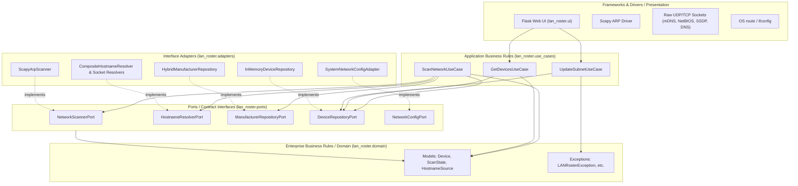
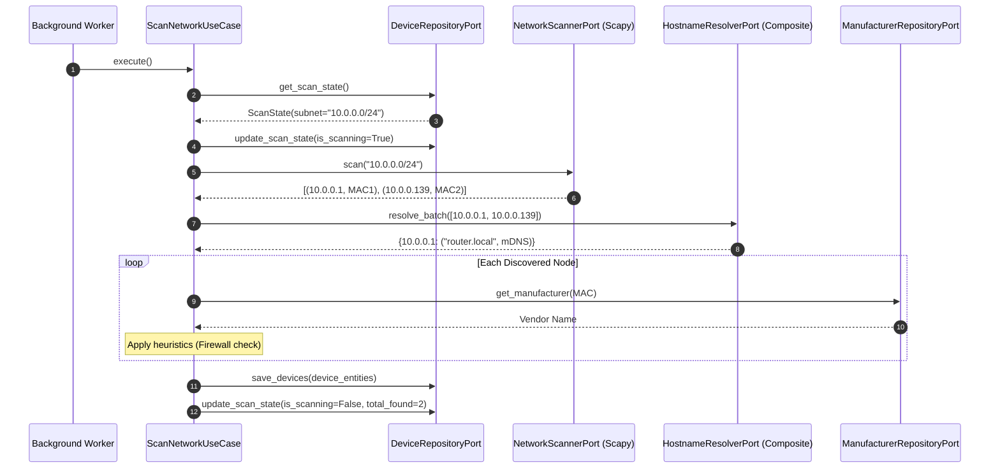
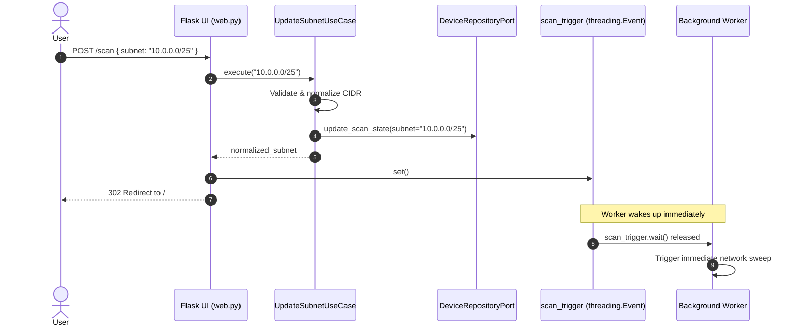

# LANRoster Architecture

This document describes the architectural principles, layer boundaries, dependency rules, and design patterns governing **LANRoster**.

---

## 1. Architectural Philosophy

LANRoster is structured around the principles of **Clean Architecture** (Robert C. Martin / Uncle Bob), also known as **Hexagonal Architecture** / **Ports and Adapters** (Alistair Cockburn) and **Onion Architecture** (Jeffrey Palermo).

### Core Goals

1. **Framework Independence**: The application business rules do not depend on external frameworks like Flask, Scapy, or operating system shells. Frameworks serve strictly as outer delivery mechanisms and replaceable plugins.
2. **UI Independence**: The core network scanning and device roster logic can be operated via web UI, REST API, CLI, or automated batch jobs without altering use cases.
3. **Database / Persistence Independence**: Devices and scanner state are decoupled through repository interfaces. The storage mechanism can transition from in-memory caches to SQLite, PostgreSQL, or Redis without business logic changes.
4. **Hardware & Network Independence**: Layer 2 ARP sweeps and multi-protocol name resolution are isolated behind contract ports. They can be substituted with simulated fixtures, alternative scanning engines (such as `arp-scan` or Nmap), or mocks during unit testing.
5. **Testability Without Privileges**: Enterprise rules and use case workflows can be validated in milliseconds without requiring root (`sudo`) permissions, active network interfaces, or live hardware.

---

## 2. The Dependency Rule



> **The Golden Rule**: Source code dependencies must point **strictly inward**. 
> - Nothing in an inner circle can know anything about something in an outer circle.
> - The Domain knows nothing of Use Cases, Ports, Adapters, or Flask.
> - Use Cases know only the Domain and Port interfaces.
> - Adapters know the Ports and Domain, translating external mechanisms into domain-compatible operations.
> - Composition occurs at the outermost boundary: the **Composition Root** ([`lan_roster.bootstrap`](file:///Users/tomhalsan/dev/LANRoster/lan_roster/bootstrap.py)).

---

## 3. Package Structure

```text
lan_roster/
├── domain/                      # Enterprise Business Rules (Zero external dependencies)
│   ├── models.py                # Core entities: Device, ScanState, HostnameSource
│   └── exceptions.py            # Base & specific domain exceptions
│
├── ports/                       # Contract Interfaces (Abstract Base Classes)
│   ├── scanner.py               # NetworkScannerPort
│   ├── resolver.py              # HostnameResolverPort
│   ├── manufacturer.py          # ManufacturerRepositoryPort
│   ├── repository.py            # DeviceRepositoryPort
│   └── network_config.py        # NetworkConfigPort
│
├── use_cases/                   # Application Business Rules (Workflows)
│   ├── scan_network.py          # ScanNetworkUseCase (orchestration & firewall heuristics)
│   ├── get_devices.py           # GetDevicesUseCase (retrieval & IP numeric ordering)
│   └── update_subnet.py         # UpdateSubnetUseCase (CIDR validation & state updates)
│
├── adapters/                    # Interface Adapters (Secondary / Driven)
│   ├── scanner/
│   │   └── scapy_arp.py         # Scapy ARP sweeping implementation
│   ├── resolvers/
│   │   ├── composite.py         # Priority composite resolver
│   │   ├── mdns.py              # Multicast DNS (UDP 5353) unicast query
│   │   ├── netbios.py           # NetBIOS Name Service (UDP 137) query
│   │   ├── ssdp.py              # SSDP / UPnP M-SEARCH (UDP 1900) query
│   │   └── dns.py               # Standard reverse DNS PTR query
│   ├── manufacturer/
│   │   └── hybrid_repo.py       # Offline OUI map + privacy bit detection + cache
│   ├── repository/
│   │   └── memory.py            # Thread-safe in-memory device & state repository
│   └── network/
│       └── system_config.py     # Subprocess route/ifconfig default subnet detection
│
├── ui/                          # Presentation Layer (Primary / Driving Adapter)
│   ├── web.py                   # Flask controller, API routes, and request handling
│   └── templates.py             # Embedded HTML/CSS/JS responsive dashboard
│
├── bootstrap.py                 # Composition Root (Dependency Injection wiring)
└── __main__.py                  # Package executable entry point (`python -m lan_roster`)

app.py                           # Root runner maintaining backwards compatibility
tests/                           # Isolated unit tests with mock ports
```

---

## 4. Layer Deep-Dive

### 4.1 Domain Layer (`lan_roster.domain`)

The domain layer encapsulates critical enterprise entities and core rules. It has **zero dependencies** on any library outside Python's standard library (`dataclasses`, `enum`, `typing`).

- **[`Device`](file:///Users/tomhalsan/dev/LANRoster/lan_roster/domain/models.py#L15-L32)**: Represents an active network node on the broadcast domain with IP, MAC address, hostname, discovery source, hardware vendor, and last-seen timestamp.
- **[`ScanState`](file:///Users/tomhalsan/dev/LANRoster/lan_roster/domain/models.py#L34-L50)**: Tracks current scanner lifecycle (target subnet, scanning status, last scan timestamp, error messages, and total discovered device count).
- **[`HostnameSource`](file:///Users/tomhalsan/dev/LANRoster/lan_roster/domain/models.py#L6-L13)**: Enumeration of discovery protocols (`mDNS`, `NetBIOS`, `SSDP`, `DNS`, `Firewalled`, `Unknown`).
- **[`Domain Exceptions`](file:///Users/tomhalsan/dev/LANRoster/lan_roster/domain/exceptions.py)**: Includes [`LANRosterException`](file:///Users/tomhalsan/dev/LANRoster/lan_roster/domain/exceptions.py#L1), [`InvalidSubnetException`](file:///Users/tomhalsan/dev/LANRoster/lan_roster/domain/exceptions.py#L6), and [`ScanExecutionException`](file:///Users/tomhalsan/dev/LANRoster/lan_roster/domain/exceptions.py#L11).

### 4.2 Ports Layer (`lan_roster.ports`)

Ports define abstract boundaries using Python's `abc.ABC`. These contracts allow use cases to execute without binding to concrete technologies:

- **[`NetworkScannerPort`](file:///Users/tomhalsan/dev/LANRoster/lan_roster/ports/scanner.py)**: Contract for broadcasting ARP requests over a target CIDR subnet and yielding `(ip, mac)` pairs.
- **[`HostnameResolverPort`](file:///Users/tomhalsan/dev/LANRoster/lan_roster/ports/resolver.py)**: Contract for resolving hostnames across an IP batch: `resolve_batch(ips) -> Dict[ip, (hostname, source)]`.
- **[`ManufacturerRepositoryPort`](file:///Users/tomhalsan/dev/LANRoster/lan_roster/ports/manufacturer.py)**: Contract for querying hardware vendors by MAC address.
- **[`DeviceRepositoryPort`](file:///Users/tomhalsan/dev/LANRoster/lan_roster/ports/repository.py)**: Contract for atomic saving, retrieving, and updating the scan state and device roster.
- **[`NetworkConfigPort`](file:///Users/tomhalsan/dev/LANRoster/lan_roster/ports/network_config.py)**: Contract for inspecting the operating system's default network route.

### 4.3 Use Cases Layer (`lan_roster.use_cases`)

Use cases represent application workflows. They coordinate domain entities and communicate exclusively through port interfaces:

- **[`ScanNetworkUseCase`](file:///Users/tomhalsan/dev/LANRoster/lan_roster/use_cases/scan_network.py)**:
  1. Sets scanning state to `True`.
  2. Executes ARP discovery via [`NetworkScannerPort`](file:///Users/tomhalsan/dev/LANRoster/lan_roster/ports/scanner.py).
  3. Triggers concurrent multi-protocol hostname resolution via [`HostnameResolverPort`](file:///Users/tomhalsan/dev/LANRoster/lan_roster/ports/resolver.py).
  4. Resolves MAC vendor via [`ManufacturerRepositoryPort`](file:///Users/tomhalsan/dev/LANRoster/lan_roster/ports/manufacturer.py).
  5. Applies business heuristic: Flags unidentified devices belonging to known PC vendors (Intel, Microsoft, Dell, Lenovo, HP, Asus, Acer) as `HostnameSource.FIREWALLED`.
  6. Atomically commits the roster to [`DeviceRepositoryPort`](file:///Users/tomhalsan/dev/LANRoster/lan_roster/ports/repository.py) and updates scan metrics.
- **[`GetDevicesUseCase`](file:///Users/tomhalsan/dev/LANRoster/lan_roster/use_cases/get_devices.py)**:
  - Fetches devices from [`DeviceRepositoryPort`](file:///Users/tomhalsan/dev/LANRoster/lan_roster/ports/repository.py).
  - Sorts IP addresses numerically by octet (e.g., `10.0.0.2` preceding `10.0.0.10`).
  - Returns the sorted roster alongside the current [`ScanState`](file:///Users/tomhalsan/dev/LANRoster/lan_roster/domain/models.py#L34).
- **[`UpdateSubnetUseCase`](file:///Users/tomhalsan/dev/LANRoster/lan_roster/use_cases/update_subnet.py)**:
  - Validates and sanitizes raw input CIDR notation using `ipaddress.ip_network`.
  - Automatically appends `/24` if the user omitted a CIDR mask.
  - Updates repository state or raises [`InvalidSubnetException`](file:///Users/tomhalsan/dev/LANRoster/lan_roster/domain/exceptions.py#L6).

### 4.4 Adapters Layer (`lan_roster.adapters`)

Adapters implement the port contracts to interact with specific infrastructure:

- **[`ScapyArpScanner`](file:///Users/tomhalsan/dev/LANRoster/lan_roster/adapters/scanner/scapy_arp.py)**: Crafts Layer 2 Ethernet broadcast frames containing ARP requests using Scapy's `srp`.
- **[`CompositeHostnameResolver`](file:///Users/tomhalsan/dev/LANRoster/lan_roster/adapters/resolvers/composite.py)**: Combines specialized resolvers using a priority cascade:
  $$\text{mDNS} \succ \text{NetBIOS} \succ \text{SSDP} \succ \text{DNS}$$
  - [`SocketMDNSResolver`](file:///Users/tomhalsan/dev/LANRoster/lan_roster/adapters/resolvers/mdns.py): Sends unicast PTR queries to UDP port 5353 and parses both `PTR` (12) and `A` (1) records for advertised `.local` hosts.
  - [`SocketNetBIOSResolver`](file:///Users/tomhalsan/dev/LANRoster/lan_roster/adapters/resolvers/netbios.py): Sends NBNS node status queries (`*` wildcard name) to UDP port 137.
  - [`SocketSSDPResolver`](file:///Users/tomhalsan/dev/LANRoster/lan_roster/adapters/resolvers/ssdp.py): Issues multicast and targeted unicast `M-SEARCH` requests (UDP 1900) and concurrent HTTP fetches (**Probe B**) to parse UPnP XML device descriptions and Google Cast API (`/setup/eureka_info` on port 8008) for `<friendlyName>`, `<manufacturer>`, and `<modelName>`.
  - [`SocketDNSResolver`](file:///Users/tomhalsan/dev/LANRoster/lan_roster/adapters/resolvers/dns.py): Queries local PTR records via `socket.gethostbyaddr` and issues direct DNS PTR queries to the local network gateway router (UDP port 53) to retrieve DHCP client hostnames (e.g. `iPhone-7544`).
- **[`HybridManufacturerRepository`](file:///Users/tomhalsan/dev/LANRoster/lan_roster/adapters/manufacturer/hybrid_repo.py)**:
  1. Inspects active UPnP/SSDP metadata registered by Probe B.
  2. Executes **Probe A (Apple Lockdown Check)**: Performs a sub-second TCP connect check on port 62078 (`apple-mobdev`/`iphone-sync`). If open, identifies the device as `Apple iOS Device (Private MAC)` or `Apple iOS Device`, cutting through randomized MAC addresses.
  3. Inspects the IEEE 802 locally-administered MAC address bit (bit 1 of first byte) to flag `Private/Randomized MAC` addresses.
  4. Queries an offline dictionary of common OUIs (Apple, Sony, Intel, Arris, Google, Samsung, etc.).
  5. Consults an in-memory runtime cache.
  6. Queries an external vendor API with timeout fallback.
- **[`InMemoryDeviceRepository`](file:///Users/tomhalsan/dev/LANRoster/lan_roster/adapters/repository/memory.py)**: Manages concurrent device updates safely via `threading.Lock`.
- **[`SystemNetworkConfigAdapter`](file:///Users/tomhalsan/dev/LANRoster/lan_roster/adapters/network/system_config.py)**: Inspects the OS routing table using `route -n get default` and `ifconfig` to automatically detect the local broadcast subnet.

### 4.5 Presentation / Primary Adapter (`lan_roster.ui`)

- **[`create_web_app`](file:///Users/tomhalsan/dev/LANRoster/lan_roster/ui/web.py)**: A factory function creating the Flask application.
  - Acts as a **Driving Adapter**: Translates incoming HTTP requests into use case calls.
  - Exposes HTML routes (`GET /`, `POST /scan`) and REST API endpoints (`GET /api/devices`, `POST /api/set-subnet`).
  - Never accesses storage, Scapy, or low-level sockets directly.

---

## 5. Composition Root & Dependency Injection

The **Composition Root** is the single location where concrete components are instantiated and wired together:

- **[`lan_roster.bootstrap.bootstrap()`](file:///Users/tomhalsan/dev/LANRoster/lan_roster/bootstrap.py#L17)**:
  1. Instantiates secondary adapters (`SystemNetworkConfigAdapter`, `InMemoryDeviceRepository`, `HybridManufacturerRepository`, `ScapyArpScanner`, `CompositeHostnameResolver`).
  2. Injects adapters into use cases (`ScanNetworkUseCase`, `GetDevicesUseCase`, `UpdateSubnetUseCase`).
  3. Spawns a background worker thread governed by a `threading.Event` synchronization trigger.
  4. Passes use cases to the Flask primary adapter factory (`create_web_app`).
- **Entry Points**:
  - [`lan_roster/__main__.py`](file:///Users/tomhalsan/dev/LANRoster/lan_roster/__main__.py): Standard package entry point (`python -m lan_roster`).
  - [`app.py`](file:///Users/tomhalsan/dev/LANRoster/app.py): Top-level convenience runner invoking `bootstrap()`.

---

## 6. Execution Flow & Sequence Diagrams

### 6.1 Background Sweep & Roster Assembly



### 6.2 User Updates Subnet via Web UI / API



---

## 7. Key Design Patterns

| Pattern | Clean Architecture Manifestation | File Location |
| :--- | :--- | :--- |
| **Ports & Adapters** | Decouples business rules from external technology via abstract interfaces. | [`lan_roster.ports`](file:///Users/tomhalsan/dev/LANRoster/lan_roster/ports/) |
| **Composite** | `CompositeHostnameResolver` presents a uniform `HostnameResolverPort` interface while coordinating multiple protocol resolvers. | [`CompositeHostnameResolver`](file:///Users/tomhalsan/dev/LANRoster/lan_roster/adapters/resolvers/composite.py) |
| **Repository** | Abstracts device persistence and scanner state from memory or persistent storage. | [`DeviceRepositoryPort`](file:///Users/tomhalsan/dev/LANRoster/lan_roster/ports/repository.py) |
| **Dependency Injection** | Instantiates dependencies externally and supplies them via constructor arguments. | [`lan_roster.bootstrap`](file:///Users/tomhalsan/dev/LANRoster/lan_roster/bootstrap.py) |
| **Composition Root** | Centralizes application assembly and wiring into a single module. | [`lan_roster.bootstrap`](file:///Users/tomhalsan/dev/LANRoster/lan_roster/bootstrap.py) |
| **Factory Method** | Produces configured Flask instances decoupled from module-level state. | [`create_web_app`](file:///Users/tomhalsan/dev/LANRoster/lan_roster/ui/web.py) |

---

## 8. Testability & Quality Assurance

By decoupling external dependencies through Ports, LANRoster achieves complete unit test isolation:

- **Rootless Testing**: Tests run in non-root user environments without raw packet permissions or active interfaces.
- **Deterministic Test Doubles**: Mock scanners and resolvers provide deterministic inputs (e.g. testing the Windows firewall heuristic and CIDR boundary conditions).
- **Sub-Second Execution**: Unit test suites execute in less than 0.1 seconds.

```bash
# Run unit tests
python3 -m unittest discover tests

# Verify static typing
pyrefly check
```

---

## 9. Extensibility Guide

### Adding a New Hostname Resolver Protocol (e.g., LLMNR or WSD)
1. Create a class implementing [`HostnameResolverPort`](file:///Users/tomhalsan/dev/LANRoster/lan_roster/ports/resolver.py).
2. Implement the `resolve_batch(ips: List[str])` method.
3. Pass the new resolver into [`CompositeHostnameResolver`](file:///Users/tomhalsan/dev/LANRoster/lan_roster/adapters/resolvers/composite.py) in [`lan_roster.bootstrap`](file:///Users/tomhalsan/dev/LANRoster/lan_roster/bootstrap.py).
4. No domain models or use cases need to be modified.

### Replacing In-Memory Storage with a Database (e.g., SQLite / PostgreSQL)
1. Create a class (e.g., `SqliteDeviceRepository`) implementing [`DeviceRepositoryPort`](file:///Users/tomhalsan/dev/LANRoster/lan_roster/ports/repository.py).
2. Replace `InMemoryDeviceRepository` with `SqliteDeviceRepository` in [`lan_roster.bootstrap`](file:///Users/tomhalsan/dev/LANRoster/lan_roster/bootstrap.py).
3. The UI, use cases, and scanner remain completely unaffected.

