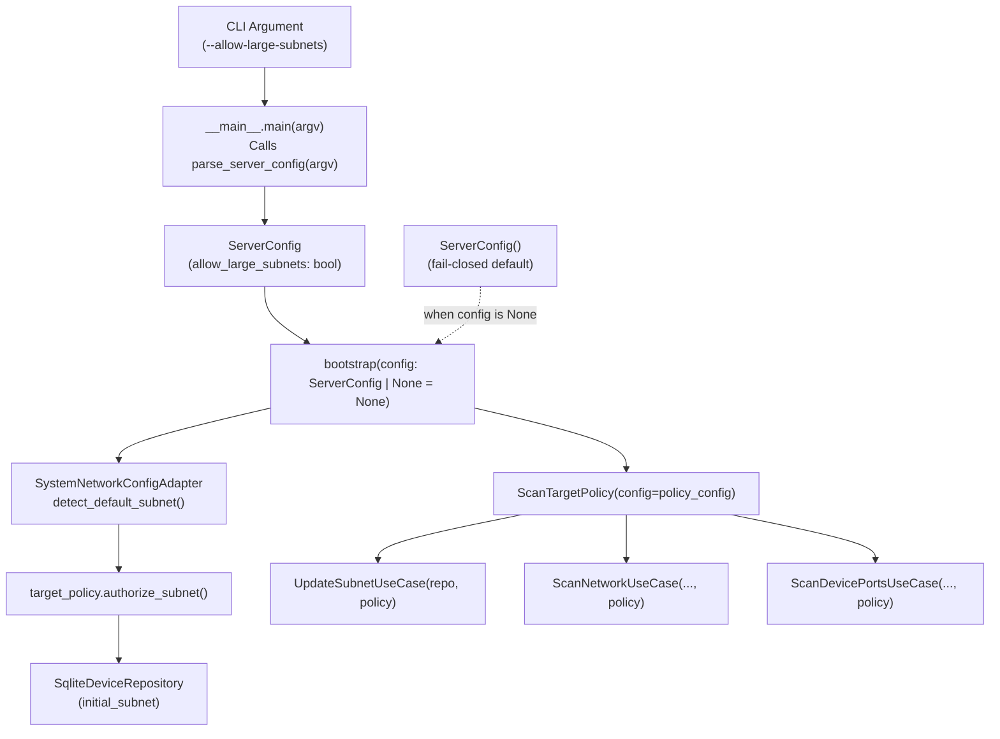
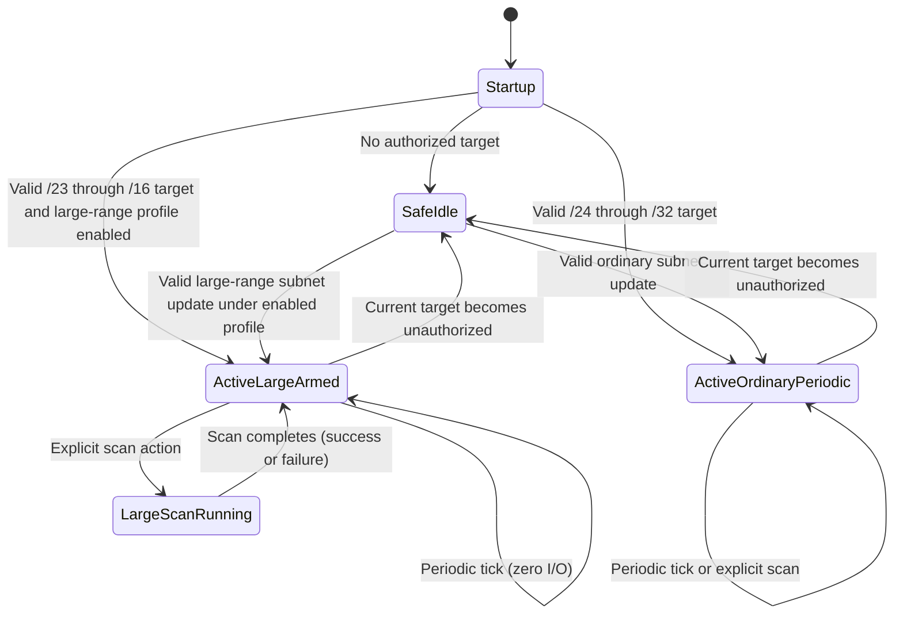

# ADR 0001: Scan Target and Subnet Authorization Policy

- **Status:** Accepted
- **Date:** 2026-11-20
- **Author:** Tom Halsan
- **Issue Reference:** GitHub Issue #13 (Define and enforce allowed subnet and scan-target policy)
- **Milestone:** v0.3
- **Priority:** P0
- **Scope:** Architecture Decision Record only (specification, architecture, and validation contract; no production implementation in this increment)

---

> [!IMPORTANT]
> **Acceptance Boundary and Implementation Gate:**
> **Decision accepted:** This ADR was accepted after independent Gemini 4 Neon review and explicit human approval. Implementation may proceed only through a separate issue branch and pull request, using the architecture and validation boundaries defined by this decision. This ADR branch remains documentation-only.

---

## 1. Context and Problem Statement

LANRoster is an automated local-network discovery tool and device directory. It translates Layer 2 Address Resolution Protocol (ARP) broadcasts, multi-protocol name resolution (mDNS, NetBIOS, SSDP, DNS), HTTP banner analysis, and active service inspection into a real-time device roster.

In LANRoster v0.2.0, scan-target handling exhibits four architectural and security deficiencies:

1. **Normalization Without Authorization:** The subnet handler in `UpdateSubnetUseCase` relies on Python's `ipaddress.ip_network(..., strict=False)`. While this normalizes valid CIDR syntax, it performs **no authorization checks** on address space or prefix size. Callers can submit arbitrary public IPv4 blocks, Carrier-Grade NAT (CGNAT), loopback addresses, link-local blocks, multicast ranges, or unbounded address spaces (such as `0.0.0.0/0` or `10.0.0.0/8`).
2. **Unvalidated Persisted Execution:** `ScanNetworkUseCase` retrieves the active target subnet directly from `device_repo.get_scan_state()` and passes it to the infrastructure scanner driver (`ScapyArpScanner.scan(state.subnet)`). If an invalid, unvetted, or legacy target exists in SQLite (from an earlier release, manual database modification, or unvalidated startup auto-detection), the background daemon executes raw ARP sweeps against that target on every scheduled tick without an authoritative policy gate.
3. **Inconsistent Service Scan Validation:** On-demand TCP port scanning in `ScanDevicePortsUseCase` checks only whether an IP string is present in the in-memory roster (`if ip not in devices:`). It does not normalize the target IP address, does not verify that the target belongs to RFC 1918 private IPv4 space, does not confirm that the target resides within the approved active subnet, and does not verify that the active subnet itself is currently authorized under the running policy profile. If an anomalous, off-subnet, or spoofed entry enters the roster, the service scanner could probe an unintended or off-link host.
4. **Unvalidated Startup Auto-Detection and Scanner Responses:** `SystemNetworkConfigAdapter` falls back to `10.0.0.0/24` or reads system routes without passing through a policy gate. Furthermore, discovered addresses returned from ARP sweeps are passed directly to downstream hostname resolvers (mDNS, NetBIOS, SSDP, DNS), HTTP banner probes, and repository persistence without verifying that the responding IP resides within the authorized active subnet.

LANRoster must operate as a strictly local, safe-by-default household discovery tool. Sweeping non-local, public, or excessively broad networks creates severe operational, privacy, and availability risks.

This Architecture Decision Record establishes a formal, centralized, and testable scan-target authorization policy for v0.3.

---

## 2. Decision Drivers and Principles

- **Clean Architecture Preservation:** Application business rules and authorization policies must point strictly inward. Domain and use-case authorization must not depend on presentation frameworks (Flask) or infrastructure drivers (Scapy, raw sockets).
- **Fail-Closed by Default:** Any input, auto-detected interface configuration, or persisted state that is empty, malformed, ambiguous, or outside the authorized policy boundary must be rejected without initiating network transmission or corrupting active operational state.
- **Seven-Stage Target Lifecycle:** Target processing must strictly separate Type Guard, ASCII Boundary Trimming, Empty Check, Strict Syntax Parsing, Normalization, Authorization, and Execution.
- **Bounded Scan Radii:** Layer 2 sweeps must have deterministic upper limits to protect local network stability and host resources. The ordinary default scan bound is `/24` (254 candidate host probes); `/16` (65,534 candidate host probes) is the absolute hard ceiling and requires explicit operator authorization. Subnets broader than `/16` are unconditionally prohibited.
- **Operational Separation of Cadence:** Ordinary ranges (`/24` through `/32`) may use the normal periodic background sweep cadence (default 30 seconds). Large ranges (`/23` through `/16`) must execute **on-demand only**, must never be scheduled periodically, require single-flight execution, and require deterministic packet pacing or rate control.
- **Decoupling Request Errors from Persisted Daemon State:** Request-scoped validation errors at API or form boundaries must return structured HTTP feedback without mutating repository state or corrupting background daemon scan state.
- **Explicit Outbound Contracts with Value Objects:** Outbound network ports must accept policy-approved domain value objects (`AuthorizedSubnet`, `AuthorizedHostTarget`) rather than unvetted strings, making authorization explicit at compile-time and runtime.
- **Deterministic and Rootless Verification:** Policy rules must be 100% testable in milliseconds using synthetic data without root privileges, raw sockets, or live network hardware.

---

## 3. Considered Alternatives

### Alternative 1: Validate Only in `UpdateSubnetUseCase`
- **Description:** Implement all validation and filtering logic exclusively inside `UpdateSubnetUseCase.execute()`.
- **Advantages:** Simple to implement; intercepts user form submissions (`POST /scan`) and API calls (`POST /api/set-subnet`) at the mutation entry point.
- **Disadvantages:**
  - Fails to protect against unvetted or legacy state persisted in SQLite upon process startup.
  - Fails to protect the background thread in `ScanNetworkUseCase`, which reads directly from `device_repo.get_scan_state()`.
  - Fails to validate subnets returned by `SystemNetworkConfigAdapter` during startup auto-detection.
  - Leaves `ScanDevicePortsUseCase` completely unprotected or forces an ad-hoc reimplementation.
  - Tightly couples scan-target authorization to subnet mutation rather than network-action execution.
- **Verdict:** **Rejected.**

### Alternative 2: Duplicate Validation Independently in Each Network-Action Use Case
- **Description:** Each use case (`UpdateSubnetUseCase`, `ScanNetworkUseCase`, `ScanDevicePortsUseCase`) independently parses, validates, and authorizes target IP networks or addresses within its own `execute()` method.
- **Advantages:** Protects each use case directly without modifying inter-class dependencies.
- **Disadvantages:**
  - Severe violation of DRY (Don't Repeat Yourself).
  - Introduces substantial risk of policy drift across use cases.
  - Redundant and fragile test maintenance.
  - Clutters application orchestration logic with low-level address classification rules.
- **Verdict:** **Rejected.**

### Alternative 3: Introduce One Shared, Injected `ScanTargetPolicy` Component (Selected)
- **Description:** Encapsulate all target normalization, RFC 1918 classification, prefix-length enforcement, and containment logic in a dedicated policy component (`ScanTargetPolicy`). The policy is instantiated and configured in the composition root (`lan_roster.bootstrap`) using operator configuration (`ServerConfig`), and injected as a dependency into `UpdateSubnetUseCase`, `ScanNetworkUseCase`, and `ScanDevicePortsUseCase`. Outbound scanner ports consume policy-minted value objects.
- **Advantages:**
  - **Single Source of Truth:** Every network action in LANRoster validates targets against identical rules.
  - **Defense-in-Depth:** Validates operator input at the API boundary, auto-detected subnets at startup, persisted targets before ARP sweeping, scanner discoveries before enrichment, and individual device IPs before TCP port probing.
  - **Clean Architecture Compliance:** The policy is pure Python, depends only on the standard library (`ipaddress`) and domain exceptions, and lives inside the domain core (`lan_roster.domain.target_policy`).
  - **Rootless Testability:** The policy can be tested exhaustively with parameterized unit tests covering valid, invalid, boundary, and bypass cases in milliseconds.
- **Verdict:** **Accepted as the preferred architectural direction.**

---

## 4. Selected Architecture and Clean Architecture Placement

### 4.1. Placement in Domain Layer: `lan_roster.domain.target_policy`
Clean Architecture (`ARCHITECTURE.md`) dictates that enterprise business rules and domain invariants live in the Domain layer (`lan_roster.domain`).

Evidence for Domain placement over Use Cases:
- **Enterprise Invariant:** What constitutes an authorized local network target (RFC 1918 containment, prefix limits) is a fundamental enterprise business rule of LANRoster, independent of any specific application workflow.
- **Clean Dependency Direction:** Placing `ScanTargetPolicy` in `lan_roster.domain.target_policy` allows `UpdateSubnetUseCase`, `ScanNetworkUseCase`, and `ScanDevicePortsUseCase` to import and depend on the policy. The Dependency Rule is strictly preserved: Use Cases depend inward on Domain; Domain knows nothing of Use Cases, Adapters, or Frameworks.
- **Consistency with Existing Domain Logic:** This directly mirrors `DeviceClassifier` (`lan_roster.domain.classifier`), which encapsulates domain rules for classifying hardware devices and is injected into use cases.

### 4.2. Policy-Native Bounded Configuration
To prevent leaking CLI concepts into the domain, `ScanTargetPolicy` is configured using domain-native bounded settings rather than CLI-shaped boolean flags:

```python
@dataclass(frozen=True)
class ScanTargetPolicyConfig:
    ordinary_min_prefix: int = 24
    active_min_prefix: int = 24
    absolute_min_prefix: int = 16

    def __post_init__(self) -> None:
        if not (16 == self.absolute_min_prefix <= self.active_min_prefix <= self.ordinary_min_prefix <= 32):
            raise ValueError("Invalid scan target policy prefix bounds")
```

**Configuration Rules:**
- `ordinary_min_prefix` defines the periodic/background boundary (`24`).
- `active_min_prefix` is `24` by default and defines the current operational ceiling.
- `absolute_min_prefix` remains immutable at `16` for v0.3.
- The domain validates the invariant: `16 == absolute_min_prefix <= active_min_prefix <= ordinary_min_prefix <= 32`.
- `ScanTargetPolicy` never receives the CLI flag name or a CLI-shaped boolean; it operates purely on numeric prefix bounds.

**Mapping at Outer Boundary (`lan_roster.server_config` and `lan_roster.bootstrap`):**
`ServerConfig` maintains the operator configuration `allow_large_subnets: bool = False`. The composition root maps this flag into the domain policy configuration before constructing `ScanTargetPolicy`:

```python
policy_config = ScanTargetPolicyConfig(
    ordinary_min_prefix=24,
    active_min_prefix=16 if server_config.allow_large_subnets else 24,
    absolute_min_prefix=16,
)
target_policy = ScanTargetPolicy(config=policy_config)
```

### 4.3. Composition Root Wiring and Entry-Point Decoupling
The operator override reaches use cases through explicit configuration in the composition root (`lan_roster.bootstrap`), eliminating process-argument coupling:



1. **CLI Parsing Ownership:**
   - `lan_roster.__main__.main(argv)` owns CLI parsing.
   - `parse_server_config(argv)` is called only by the CLI entry point with an explicit argument list.
2. **Bootstrap Independence (`lan_roster.bootstrap`):**
   - `bootstrap(config: ServerConfig | None = None) -> Flask` **must not read `sys.argv`**.
   - When `config is None`, `bootstrap()` instantiates `ServerConfig()` with fail-closed defaults (`allow_large_subnets=False`).
   - `app.py` retains zero-argument import compatibility: `app = bootstrap()`.
   - WSGI servers, `unittest`, `pytest`, and external Python callers remain completely uncoupled from process arguments.
3. **Presentation Boundary Isolation:**
   - The web presentation layer has **no capability** to alter `active_min_prefix`; web callers cannot bypass the operator's startup policy.

### 4.4. Why Outer Layers Must Not Own Policy
- **Flask Presentation Layer (`lan_roster.ui`):** Flask is an inbound delivery adapter. Placing validation in route handlers leaves CLI entry points, daemon threads, auto-detection, and background workers unprotected. Presentation adapters must only translate HTTP inputs to use case invocations and map domain exceptions to HTTP responses.
- **Scapy Infrastructure Driver (`lan_roster.adapters.scanner`):** Scapy is an outbound infrastructure driver responsible for assembling Layer 2 frames. It must remain decoupled from enterprise authorization logic so it can be swapped for alternative drivers or test fixtures without bypassing security constraints.

---

## 5. Policy Specification

### 5.1. Authorized Address Space (RFC 1918 Private IPv4 Only)
LANRoster authorizes exclusively the three standard private IPv4 address blocks defined in RFC 1918:

| RFC 1918 Block | Canonical Root CIDR | Subnet Mask | Address Range | Total Addresses |
| :--- | :--- | :--- | :--- | :--- |
| **24-bit block** | `10.0.0.0/8` | `255.0.0.0` | `10.0.0.0` - `10.255.255.255` | 16,777,216 |
| **20-bit block** | `172.16.0.0/12` | `255.240.0.0` | `172.16.0.0` - `172.31.255.255` | 1,048,576 |
| **16-bit block** | `192.168.0.0/16` | `255.255.0.0` | `192.168.0.0` - `192.168.255.255` | 65,536 |

### 5.2. Inclusive RFC 1918 Containment
To be authorized, a target network must be **contained within, meaning equal to or a subnet of, one of the exact RFC 1918 root networks** (`target_network.subnet_of(root_network)` evaluated inclusively).

Explicit status of `192.168.0.0/16`:
- In ordinary mode (`active_min_prefix=24`), `192.168.0.0/16` is rejected because its prefix length (`/16`) exceeds the active ordinary bound (`/24`).
- Under the explicit large-range profile (`active_min_prefix=16`), `192.168.0.0/16` is **authorized by address policy** because it is equal to the RFC 1918 16-bit root block and satisfies `prefix_len >= 16`. It remains strictly subject to large-scan on-demand execution guardrails (Section 8).

### 5.3. Explicitly Prohibited Address Space
The following address ranges and protocols are strictly prohibited from network sweeps and service scans:

1. **IPv6 (All Spaces):** All IPv6 addresses and prefixes (including Unique Local Addresses `fc00::/7`, link-local `fe80::/10`, IPv4-mapped IPv6 `::ffff:0:0/96`, and global unicast `2000::/3`) are rejected in v0.3.
2. **Public / Globally Routable IPv4:** Any unicast address outside RFC 1918 allocations.
3. **Loopback (`127.0.0.0/8` - RFC 1122):** Loopback interfaces must never be subjected to ARP sweeps or remote service probing.
4. **Link-Local / APIPA (`169.254.0.0/16` - RFC 3927):** Auto-configured link-local addresses do not represent authoritative routed subnets.
5. **Carrier-Grade NAT / Shared Address Space (`100.64.0.0/10` - RFC 6598):** Used between customer routers and ISP CGNAT infrastructure; sweeping this range risks probing ISP infrastructure or co-tenants.
6. **Multicast (`224.0.0.0/4` - RFC 5771):** Multicast addresses are not valid Layer 2 sweep targets.
7. **Unspecified / "This Host on This Network" (`0.0.0.0/8` - RFC 1122):** Addresses in `0.0.0.0/8` (including `0.0.0.0/32`) and the default route notation `0.0.0.0/0` are prohibited.
8. **Limited Broadcast (`255.255.255.255/32` - RFC 919):** Parsed successfully by Python's `ipaddress`, but rejected by policy.
9. **Benchmarking & Documentation Ranges (RFC 2544 / RFC 5737):** `198.18.0.0/15`, `192.0.2.0/24`, `198.51.100.0/24`, `203.0.113.0/24` are prohibited.
10. **Reserved for Future Use (`240.0.0.0/4` - Former Class E):** Prohibited.

### 5.4. Python Version Sensitivity and Inadequacy of `is_private`
LANRoster officially supports Python 3.10, 3.11, 3.12, 3.13, and 3.14 (declared via `requires-python = ">=3.10"` in `pyproject.toml` and verified in `.github/workflows/ci.yml`).

Relying on standard library `network.is_private` as an authorization gate is fundamentally unsafe:
- `IPv4Network("198.18.0.0/15").is_private` evaluates to `True` (RFC 2544 benchmark space).
- `IPv4Network("169.254.0.0/16").is_private` evaluates to `True` (RFC 3927 link-local space).
- `IPv4Network("10.0.0.0/8").is_private` evaluates to `True` (16.7 million addresses; unbounded).
- `IPv4Network("255.255.255.255/32").is_private` evaluates to `True` (limited broadcast).
- `IPv6Network("fc00::/7").is_private` evaluates to `True` (IPv6 ULA).
- Standard library classification tables and related IP address attributes may change across supported Python maintenance releases (3.10 through 3.14). Explicit RFC 1918 containment is authoritative regardless of `is_private` or `is_global` behavior.

**Conclusion:** LANRoster relies exclusively on explicit mathematical containment within the three canonical RFC 1918 root blocks (`target.subnet_of(root)`), coupled with explicit prefix length verification.

---

## 6. Authorized Value Objects and Outbound Port Contracts

### 6.1. Domain Value Objects
To make policy approval explicit across architecture boundaries, the architecture introduces immutable domain value objects:

```python
@dataclass(frozen=True)
class AuthorizedSubnet:
    network: ipaddress.IPv4Network
    is_large_range: bool

    @property
    def cidr(self) -> str:
        return str(self.network)

    @property
    def prefixlen(self) -> int:
        return self.network.prefixlen


@dataclass(frozen=True)
class AuthorizedHostTarget:
    ip: ipaddress.IPv4Address
    active_subnet: ipaddress.IPv4Network

    @property
    def address(self) -> str:
        return str(self.ip)
```

**Realistic Enforcement Semantics:**
- `AuthorizedSubnet` and `AuthorizedHostTarget` make policy approval explicit in outbound contracts.
- Static analysis (Pyrefly / mypy) and runtime type checks detect accidental bypasses.
- Constructors and factories are centralized in `ScanTargetPolicy` by convention and module design.
- Adapters must still reject invalid object types at runtime.
- Security does not rely solely on Python access restrictions or assume dataclasses provide impenetrable compile-time guarantees; defense-in-depth is maintained at each layer.

### 6.2. Endpoint Enumeration Semantics
`AuthorizedSubnet` exposes the exact network target. Endpoint enumeration adheres to strict prefix semantics:
- **Prefix lengths `<= /30`:** Enumerate `network.hosts()`. Traditional network identifier (`network_address`) and directed broadcast (`broadcast_address`) are excluded from sweeping.
- **`/31` Subnets (RFC 3021 Point-to-Point):** RFC 3021 defines point-to-point links having only two addresses. Traditional network and directed broadcast exclusions do not apply; `network.hosts()` yields both endpoints.
- **`/32` Subnets (Single Host):** Represents an exact host address. Traditional exclusions do not apply; `network.hosts()` yields the single host endpoint.

**Measured Workload Candidate Host Probes:**
- `/24`: 254 candidate host probes (`2^(32-24) - 2`)
- `/16`: 65,534 candidate host probes (`2^(32-16) - 2`)
- `/31`: 2 candidate host probes (RFC 3021 endpoints)
- `/32`: 1 candidate host probe (single diagnostic target)

### 6.3. Outbound Port Signatures and Adapter Migration
Current outbound ports accept unvetted `str` targets. During implementation, these signatures will be updated:

```python
class NetworkScannerPort(ABC):
    @abstractmethod
    def scan(self, target: AuthorizedSubnet) -> List[Tuple[str, str]]:
        pass


class ServiceScannerPort(ABC):
    @abstractmethod
    def scan_ports(
        self, target: AuthorizedHostTarget, ports: List[int] | None = None
    ) -> List[int]:
        pass
```

**Scapy Adapter Migration:**
In v0.2.0, `ScapyArpScanner.scan(target_subnet: str)` passes `ARP(pdst=target_subnet)`, relying on Scapy's internal CIDR expansion. For `/24`, Scapy sweeps all 256 addresses (including `.0` and `.255`). For `/16`, Scapy sweeps all 65,536 addresses.
The implementation must update `ScapyArpScanner` to consume `AuthorizedSubnet` and sweep the exact sequence of authorized endpoints yielded by `network.hosts()` (or an explicit sequence of authorized IP strings), eliminating reliance on implicit Scapy broadcast expansion.

**Active Enrichment Ports Clarification:**
In v0.3, active enrichment ports (mDNS, NetBIOS, SSDP, DNS, HTTP banner resolvers) may continue to accept normalized host IP strings, provided that `ScanNetworkUseCase` converts or derives those strings exclusively from policy-approved discovered host targets (`AuthorizedHostTarget`). Future port typing may extend `AuthorizedHostTarget` directly into enrichment port signatures, but this is not required for Issue #13 because the pre-enrichment policy gate is deterministic, fully tested, and guarantees that no un-authorized or off-subnet target reaches enrichment adapters.

---

## 7. Parsing and Normalization Grammar

### 7.1. Seven-Stage Target Lifecycle
Target handling strictly separates seven sequential stages:

```mermaid
flowchart TD
    Stage1["1. Type Guard\n- Reject non-str (int, bool, bytes, None, list)"] --> Stage2["2. ASCII Boundary Trimming\n- Strip ASCII whitespace (' ', '\\t', '\\r', '\\n')\n- Reject Unicode whitespace"]
    Stage2 --> Stage3["3. Empty Check\n- Reject empty string (\"\")\n- Empty input never defaults"]
    Stage3 --> Stage4["4. Strict Syntax Parsing\n- Subnet: canonical 'a.b.c.d/p'\n- Service: canonical bare 'a.b.c.d'\n- Reject leading zeros, /024, hex, octal, netmasks"]
    Stage4 --> Stage5["5. Normalization\n- Subnet: zero host bits (strict=False)\n- Construct IPv4Network / IPv4Address"]
    Stage5 --> Stage6["6. Authorization\n- Check RFC 1918 containment\n- Check prefix bounds & active profile\n- Check active subnet for host targets\n  (roster verified by use case)"]
    Stage6 --> Stage7["7. Execution\n- Pass AuthorizedSubnet to NetworkScannerPort\n- Pass AuthorizedHostTarget to ServiceScannerPort"]
```

### 7.2. Strict Parsing Contract
1. **Type Guard:** Input must be strictly `str`. Any other type (`int`, `bool`, `bytes`, `None`, `list`, `dict`) immediately raises `InvalidSubnetException` or `InvalidScanTargetException`.
2. **ASCII Boundary Trimming:** Only ASCII whitespace (`" "`, `"\t"`, `"\r"`, `"\n"`) is stripped from boundaries. Unicode whitespace (such as non-breaking space `\u00a0`) and embedded whitespace are strictly rejected.
3. **Empty Check:** Empty strings (`""`) are rejected immediately. Empty input must never default to an active target.
4. **Strict Syntax Grammar:**
   - **Subnet Updates (`UpdateSubnetUseCase`, `POST /scan`, `POST /api/set-subnet`):**
     - Strictly requires explicit CIDR notation: `a.b.c.d/p`.
     - Bare IP strings without `/` are rejected with `InvalidSubnetException`. The v0.2.0 behavior of silently appending `/24` to bare IPs is permanently removed.
     - Dotted netmasks (e.g. `192.168.1.0/255.255.255.0`) and hostmasks/wildcard masks (e.g. `192.168.1.0/0.0.0.255`) are strictly rejected.
     - Prefix lengths with leading zeros (e.g. `/024`, `/016`) are strictly rejected.
     - Octets with leading zeros (e.g. `192.168.01.0`) are strictly rejected.
     - Non-dotted integer formats (`2130706433`), hexadecimal, octal, shortened IPs (`10.1/16`), and IPv4-mapped IPv6 (`::ffff:192.168.1.0/120`) are strictly rejected.
   - **Service Scans (`ScanDevicePortsUseCase`, `POST /api/device/scan-ports`):**
     - Strictly requires a bare IPv4 address: `a.b.c.d`.
     - Slash-containing CIDR notation (e.g. `192.168.1.50/32` or `192.168.1.50/24`) is strictly rejected with `InvalidScanTargetException`.
5. **Normalization:**
   - Subnets: Instantiates `ipaddress.IPv4Network(target, strict=False)` to clear host bits (e.g. `192.168.1.45/24` normalizes to `192.168.1.0/24`).
   - Hosts: Instantiates `ipaddress.IPv4Address(target)`.
6. **Authorization:** Checks RFC 1918 containment, prefix bounds, safe-idle state, and active-subnet containment. *(Note: `ScanTargetPolicy` performs pure domain validation including syntax, normalization, RFC 1918 authorization, endpoint validity, and active-subnet containment; repository roster presence is verified subsequently by `ScanDevicePortsUseCase`, ensuring the domain policy remains pure and independent of repositories).*
7. **Execution:** Value objects minted and passed to outbound adapters.

---

## 8. Ordinary and Large-Range Execution Modes

### 8.1. Operational Separation of Cadence
LANRoster establishes a strict two-tier operational model:

1. **Ordinary Scan Range (`/24` through `/32`):**
   - Covers up to 254 candidate host probes.
   - Permitted under default startup configuration (`active_min_prefix=24`).
   - **Cadence:** Executes on the normal periodic background sweep cadence (default 30 seconds) or via on-demand trigger. A valid ordinary subnet update may set the scan trigger event.
2. **Large Scan Range (`/23` through `/16`):**
   - Covers from 510 up to 65,534 candidate host probes.
   - Requires explicit operator startup authorization (`--allow-large-subnets`, setting `active_min_prefix=16`).
   - **On-Demand Only:** Large-range scans **must not run on the normal periodic background cadence**. The background worker sleeps or remains idle when a large range is active; periodic background ticks perform zero network I/O.
   - **Arming Semantics:** Submitting or updating a large-range subnet **arms the target but does not launch a scan**. A separate, explicit operator scan action is required for every large scan.
   - **Single-Flight Execution:** Exactly one large-range scan may run at any time. A second scan cannot overlap or execute concurrently; overlapping requests return `SCAN_ALREADY_IN_PROGRESS` / `HTTP 409`.
   - **Return to Armed State:** Upon successful or failed completion of an on-demand large sweep, the system returns to `ActiveLargeArmed`.
   - **Packet Pacing and Rate Control:** Requires bounded transmission rate (packet pacing or batch intervals) to prevent broadcast storming, buffer exhaustion, and local switch disruption.
   - **Measured Physical Impact:** Physical impact varies by interface, hardware, network traffic, Scapy behavior, pacing, and packet-capture implementation. Hardcoded numeric packet rates are intentionally avoided in this ADR; the implementation issue will benchmark, calibrate, and validate safe bounded rates across physical testbeds.
   - Physical validation begins at `/23` and increases gradually (`/23` -> `/22` -> `/20` -> `/16`).
   - `/16` is an absolute ceiling, not a recommended routine size. Subnets broader than `/16` (`/15`, `/12`, `/8`, `/0`) are strictly prohibited under all circumstances.

### 8.2. Clarification of Large-Range Triggering and Issue #14 Boundary
- **Eligibility vs. Invocation:** Startup authorization (`--allow-large-subnets`) only makes `/23` through `/16` eligible; it does not trigger a scan.
- **UI/API Triggering:** Browser and API callers cannot change the policy profile or enable large-range support. However, once an operator has authorized a large range at startup, an on-demand scan of that approved range may still be triggered through the current UI or API endpoints until GitHub Issue #14 introduces dedicated authentication and authorization for state-changing operations.
- **Responsibility Division:** Issue #13 governs target validity and scan cadence authorization; Issue #14 governs authentication, CSRF protection, and who or what may invoke state-changing actions. Issue #13 does not provide authentication or CSRF protection.

### 8.3. The /24-to-/23 Ordinary/Large Cadence Boundary
The decision to draw the line between ordinary periodic scanning and on-demand large-range scanning between `/24` and `/23` balances network hygiene against operator convenience:
- RFC 1918 allocations are massive: `10.0.0.0/8` contains 16.7 million addresses, and `172.16.0.0/12` contains 1.04 million addresses. Treating all RFC 1918 space as routine local scanning targets would overwhelm typical local links.
- In consumer, small-office, and standard residential environments, `/24` (254 candidate host addresses) represents the standard Layer 2 broadcast domain.
- Moving from `/24` to `/23` (510 candidate host addresses) doubles the broadcast volume. ARP broadcast frames do not traverse Layer 3 routers; they saturate the local Layer 2 broadcast domain. Unattended, periodic sweeping of 510+ addresses every 30 seconds generates continuous background broadcast noise that can degrade low-power IoT devices and congested Wi-Fi channels.
- Setting the ordinary boundary at `/24` ensures that routine unattended background scanning never exceeds 254 packets per cycle, while operator-authorized large ranges require intentional opt-in and execute on-demand with rate pacing.

---

## 9. Startup Auto-Detection Validation and Persistence Rules

### 9.1. Normative Requirement
Validation of auto-detected subnets is a **binding normative requirement**:
Every subnet returned by `SystemNetworkConfigAdapter` (`detect_default_subnet()`) must pass through `ScanTargetPolicy` before:
- Persistence into SQLite (`SqliteDeviceRepository(initial_subnet=...)`);
- Background scan-trigger scheduling;
- Construction of an `AuthorizedSubnet` target.

### 9.2. Startup Target Evaluation Ordering
To ensure consistent startup initialization:
1. **Evaluate Persisted SQLite Target First:** LANRoster inspects SQLite for any pre-existing target before querying system routes.
2. **Legacy Unauthorized Preservation:** If a pre-existing target exists in SQLite and fails current policy authorization, it is **preserved for audit and evidence**, and the application transitions immediately into `SafeIdle`.
3. **Auto-Detection Execution:** `SystemNetworkConfigAdapter.detect_default_subnet()` is executed **only when no target exists in SQLite** (such as on first initialization) or when an explicit migration routine requires re-detection.
4. **Zero Persistence of Invalid Detected Subnets:** A newly auto-detected subnet that fails policy validation is **never persisted** to SQLite.
5. **Execution Invariant:** Under no circumstances is an unauthorized target (newly detected or pre-existing) used for network I/O.
6. **Remediation:** Resolving safe-idle requires an explicit, valid operator update via UI/API or restarting with the appropriate startup profile (`--allow-large-subnets`).

### 9.3. Fail-Closed Safe-Idle Behavior
If the auto-detected subnet fails validation (e.g. the host is directly attached to a public WAN interface, a CGNAT `100.64.0.0/10` link, a link-local `169.254.0.0/16` network, or an oversized range without the override flag):
- The invalid subnet is not persisted.
- Background scanning is not scheduled.
- **Zero network I/O is performed.**
- The application enters **deterministic `SafeIdle` state**.
- An operator-facing startup warning is logged to the console and displayed in the UI banner.
- **No silent fallback:** LANRoster **must not** silently fall back to `10.0.0.0/24` or any other synthetic subnet. If auto-detection yields an unauthorizable subnet, safe-idle is the only permitted state.

---

## 10. Discovery-Result Filtering

### 10.1. Normative Requirement
Every `(ip, mac)` pair returned by `NetworkScannerPort.scan()` must be strictly verified against policy before downstream processing:
1. Parsed and normalized as an IPv4 address;
2. Authorized as RFC 1918 private IPv4;
3. Verified to reside strictly within the exact authorized active subnet (`ip in active_subnet`);
4. Verified to be a valid host endpoint under prefix semantics (not network identifier or directed broadcast on `<= /30`).

### 10.2. Pre-Enrichment Verification
This verification must execute before:
- Hostname resolution (mDNS, NetBIOS, SSDP, DNS);
- Active HTTP banner probing;
- Service port scanning;
- Network manufacturer lookup that performs network I/O;
- Device repository persistence (`device_repo.upsert_device()`).

### 10.3. Dropping Spoofed or Off-Subnet Replies
Any packet or reply claiming an off-subnet or unauthorized IP is dropped immediately and logged at warning level as an anomalous or spoofed response. Dropped IPs are not persisted and are never targeted for enrichment or service scans.

---

## 11. Service-Scan Policy and Endpoint Contract

### 11.1. Active Subnet Re-Authorization
`ScanDevicePortsUseCase` must evaluate the persisted active subnet against `ScanTargetPolicy` on every invocation before evaluating target host containment.

If the persisted active subnet is empty, malformed, unauthorized under the current policy profile, or the application is in safe-idle:
- Reject the service scan immediately;
- Perform zero socket I/O;
- Raise `NoAuthorizedActiveSubnetException`;
- Map deterministically to **`HTTP 409 Conflict`**.

### 11.2. Host Target Authorization Criteria and Separation of Concerns
A service scan target is evaluated against strict authorization criteria with clear architectural separation:
1. **Bare IP Syntax:** Input parses as a bare IPv4 address (no CIDR notation).
2. **Subnet-Independent RFC 1918 Unicast:** IP resides within RFC 1918 private space and is not an intrinsically prohibited address.
3. **Active Subnet Authorization:** Persisted active subnet is authorized and running under the active policy profile.
4. **Active-Subnet-Dependent Validity:** Target IP falls strictly within the currently authorized active subnet (`target_ip in active_subnet`), and for subnets `<= /30`, is not the network or directed broadcast address.
5. **Roster Presence:** Target IP is registered in the active device repository.

**Separation of Responsibilities:**
- **Domain Policy Responsibility:** `ScanTargetPolicy` validates input syntax, normalizes the bare IP address, verifies RFC 1918 private space membership, checks endpoint validity (rejecting network/broadcast addresses on `<= /30`), and confirms active-subnet containment. The domain policy remains pure and has no dependency on repositories.
- **Use Case Responsibility:** `ScanDevicePortsUseCase` coordinates with `device_repo` to verify that the authorized IP exists in the current device roster. If absent, the use case raises `DeviceNotFoundException` (mapped to `HTTP 404 Not Found`).

### 11.3. Service Scan Operational Guardrails
- **Single-Flight / Cooldown:** Service scans against a target IP enforce single-flight execution (no concurrent duplicate scans against the same host; returns `SCAN_ALREADY_IN_PROGRESS` / `HTTP 409`) and a bounded cooldown interval (returns `SERVICE_SCAN_COOLDOWN_ACTIVE` / `HTTP 429`) to prevent aggressive port hammering.

### 11.4. Endpoint Contract and Route Alignment
- **Preferred API Endpoint:** Transition service scanning to receive the target IP in a JSON request body:
  - `POST /api/device/scan-ports` with payload `{"ip": "192.168.1.50"}`.
- **Compatibility Transition:** The existing path endpoint `POST /api/device/<ip>/scan-ports` is preserved during transition.
  - **Routing Level Behavior:** In Flask, the `<ip>` string converter strictly rejects slashes (`/`) at the URL routing level before the view is reached, returning `HTTP 404 Not Found` for CIDR forms like `192.168.1.50/24`.
  - `HTTP 400 Bad Request` applies to malformed single-segment bare IP forms reaching the view (e.g. `999.999.999.999`, `invalid-host`).

---

## 12. Safe-Idle State Machine and State Mutation

### 12.1. Three-State Operational Model
LANRoster establishes three explicit operational states:

1. **`SafeIdle`:** No authorized operational subnet. Zero periodic and manual network I/O. Service scans disabled. Stale roster visible read-only and labeled historical/stale. Devices are never represented as currently online based on old records.
2. **`ActiveOrdinaryPeriodic`:** Authorized RFC 1918 `/24` through `/32` target. Periodic background sweeps (default 30s) and manual sweeps allowed. No overlapping execution.
3. **`ActiveLargeArmed`:** Authorized RFC 1918 `/23` through `/16` target under enabled large-range startup profile. Periodic ticks perform zero network I/O. Subnet updates arm the target without launching a scan. An explicit operator action transitions to `LargeScanRunning` to execute one single-flight, paced scan, returning to `ActiveLargeArmed` upon completion.



**State Transition Rules:**
- `Startup --> SafeIdle`: No valid authorized subnet exists in SQLite or detected.
- `Startup --> ActiveOrdinaryPeriodic`: Valid RFC 1918 `/24` through `/32` loaded.
- `Startup --> ActiveLargeArmed`: Valid RFC 1918 `/23` through `/16` loaded and `--allow-large-subnets` active.
- `SafeIdle --> ActiveOrdinaryPeriodic`: Operator submits valid `/24` through `/32` subnet update.
- `SafeIdle --> ActiveLargeArmed`: Operator submits valid `/23` through `/16` subnet update under active large-range profile.
- `ActiveOrdinaryPeriodic --> ActiveOrdinaryPeriodic`: Periodic worker tick or manual scan trigger executes background sweep.
- `ActiveLargeArmed --> ActiveLargeArmed`: Periodic worker tick executes, logs idle state, performs **zero network I/O**.
- `ActiveLargeArmed --> LargeScanRunning`: Operator triggers explicit on-demand scan action.
- `LargeScanRunning --> ActiveLargeArmed`: Paced scan completes (success or failure).
- Any active state `--> SafeIdle`: Current persisted target becomes unauthorized under running profile.
- **Failed update:** Any validation failure in a subnet update leaves the current operational state completely unchanged.

### 12.2. Daemon Error Deduplication
The safe-idle error message is written to SQLite exactly once upon state transition. The background worker daemon must **not** execute duplicate SQLite writes on every scheduled 30-second tick while in safe-idle.

### 12.3. Error Clearing and Transition Rules
- A valid authorized update transitions the application out of `SafeIdle`:
  - An ordinary `/24` through `/32` target transitions to `ActiveOrdinaryPeriodic` and may set the normal scan trigger.
  - An authorized large `/23` through `/16` target transitions to `ActiveLargeArmed` and performs zero network I/O until a separate explicit operator scan action.
- A successful background scan execution clears any stale execution errors.

### 12.4. Non-Mutation on Subnet Update Failure
When a user submits an invalid or unauthorized subnet via `UpdateSubnetUseCase`:
- The active subnet (`ScanState.subnet`) in SQLite remains completely unchanged.
- The active device roster is preserved (existing devices are not deleted).
- Background scan trigger (`scan_trigger.set()`) is suppressed.
- Request-scoped error feedback is returned to the caller; persisted `ScanState` is not modified.

### 12.5. TOCTOU (Time-of-Check to Time-of-Use) Protection
To prevent race conditions during long-running scans:
1. `ScanNetworkUseCase` takes a snapshot of the authorized active subnet at scan initiation.
2. Prior to committing discovered devices to SQLite, the use case re-checks that the active subnet in the repository equals the snapshot.
3. If the active subnet was modified mid-scan by the operator, the in-flight scan results are safely discarded without mutating the device roster.

---

## 13. Request-Scoped vs. Daemon Error Handling

To prevent presentation errors from corrupting daemon state, error handling is strictly decoupled:

1. **JSON API Endpoints (`POST /api/set-subnet`, `POST /api/device/scan-ports`):**
   - Validation failures return structured HTTP error responses (HTTP 400, 403, 404, 409, 422, 429).
   - They do **not** mutate SQLite repository state.
   - Successful subnet updates return `HTTP 200 OK` with the canonical normalized subnet string.
2. **HTML Form Endpoint (`POST /scan`):**
   - Validation failures use transient request-scoped feedback (such as Flask flash messages or template parameters).
   - They do **not** persist error strings into `ScanState.error_message`.
3. **Daemon State (`ScanState.error_message`):**
   - Reserved exclusively for background scan execution failures, hardware pre-flight errors (e.g. missing Npcap), and startup safe-idle state.

---

## 14. Error and HTTP Taxonomy

### 14.1. Domain Exceptions and Machine-Readable Error Codes
Domain exceptions in `lan_roster.domain.exceptions` include machine-readable error codes:

| Domain Exception | Machine-Readable Code | HTTP Status | Description |
| :--- | :--- | :--- | :--- |
| `InvalidSubnetException` | `INVALID_SUBNET_SYNTAX` | `HTTP 400` | Subnet string is malformed, non-string, missing CIDR prefix, leading zeros, or invalid syntax. |
| `InvalidScanTargetException` | `INVALID_HOST_TARGET_SYNTAX` | `HTTP 400` | Host target string is malformed, non-string, or contains CIDR notation. |
| `UnauthorizedSubnetException` | `UNAUTHORIZED_SUBNET_RANGE` | `HTTP 403` | Subnet falls outside RFC 1918 space (public, CGNAT, loopback, link-local, multicast, IPv6). |
| `UnauthorizedSubnetException` | `SUBNET_EXCEEDS_ABSOLUTE_LIMIT` | `HTTP 403` | Subnet prefix is broader than the immutable `/16` ceiling (e.g. `/15`, `/12`, `/8`, `/0`). |
| `UnauthorizedSubnetException` | `SUBNET_REQUIRES_OPERATOR_OVERRIDE` | `HTTP 422` | Subnet is valid RFC 1918 `/23` through `/16`, but operator startup override is not enabled. |
| `UnauthorizedScanTargetException` | `UNAUTHORIZED_HOST_TARGET` | `HTTP 403` | Host target is non-RFC 1918, off-subnet, or an excluded endpoint (network/broadcast on `<= /30`). |
| `DeviceNotFoundException` | `DEVICE_NOT_IN_ROSTER` | `HTTP 404` | Valid and authorized host target is not currently present in the device roster. |
| `NoAuthorizedActiveSubnetException` | `NO_AUTHORIZED_ACTIVE_SUBNET` | `HTTP 409` | Active subnet is empty, malformed, unauthorized, or daemon is in safe-idle. |
| `ScanConflictException` | `SCAN_ALREADY_IN_PROGRESS` | `HTTP 409` | A scan is already actively running for the requested target or large range. |
| `ScanRateLimitException` | `SERVICE_SCAN_COOLDOWN_ACTIVE` | `HTTP 429` | Service scan requested before the host cooldown period expired. |

### 14.2. Exact Subnet-Update Precedence
Subnet updates (`POST /api/set-subnet`, `UpdateSubnetUseCase`) adhere to strict four-step evaluation precedence:

1. **Type and Strict Syntax Validation:**
   - Failure (non-string, missing `/`, leading zero octets, `/024`, dotted netmask, hostmask, hex, octal, shortened IP) -> **`HTTP 400 Bad Request`** with `INVALID_SUBNET_SYNTAX`.
2. **RFC 1918 Address Authorization and Absolute Limit:**
   - Outside RFC 1918 (public, CGNAT, loopback, link-local, multicast, IPv6) -> **`HTTP 403 Forbidden`** with `UNAUTHORIZED_SUBNET_RANGE`.
   - Broader than `/16` (e.g. `/15`, `/8`, `/0`) -> **`HTTP 403 Forbidden`** with `SUBNET_EXCEEDS_ABSOLUTE_LIMIT`.
3. **Active Policy-Profile Size Check:**
   - Valid RFC 1918 `/23` through `/16` without large-range startup authorization -> **`HTTP 422 Unprocessable Entity`** with `SUBNET_REQUIRES_OPERATOR_OVERRIDE`.
4. **Success:**
   - Valid ordinary subnet (`/24` through `/32`) -> **`HTTP 200 OK`** (transitions to `ActiveOrdinaryPeriodic`, sets scan trigger).
   - Valid large subnet (`/23` through `/16`) under large-range profile -> **`HTTP 200 OK`** (transitions to `ActiveLargeArmed`, arms target, zero I/O until explicit operator scan).

**Normative Subnet Evaluation Examples:**
- `8.8.0.0/16` -> **`HTTP 403 Forbidden`** (`UNAUTHORIZED_SUBNET_RANGE`: outside RFC 1918).
- `10.0.0.0/15` -> **`HTTP 403 Forbidden`** (`SUBNET_EXCEEDS_ABSOLUTE_LIMIT`: exceeds absolute `/16` limit).
- `10.1.0.0/20` without `--allow-large-subnets` -> **`HTTP 422 Unprocessable Entity`** (`SUBNET_REQUIRES_OPERATOR_OVERRIDE`).
- `10.1.0.0/20` with `--allow-large-subnets` -> **`HTTP 200 OK`** (arms on-demand large-range state).
- `192.168.1.0/24` -> **`HTTP 200 OK`** (arms and triggers periodic scanning).

### 14.3. Exact Service-Scan Precedence
Service scan requests (`POST /api/device/scan-ports`, `ScanDevicePortsUseCase`) adhere to strict seven-step evaluation precedence:

1. **Submitted Host Type and Syntax:**
   - Reject non-string, malformed IPv4, or CIDR input -> **`HTTP 400 Bad Request`** with `INVALID_HOST_TARGET_SYNTAX`.
   - *(Note: Evaluated first; malformed input returns HTTP 400 even during SafeIdle).*
2. **Subnet-Independent Host Authorization:**
   - Reject non-RFC 1918 and intrinsically prohibited host addresses (public, CGNAT, loopback, link-local, multicast, limited broadcast, IPv6) -> **`HTTP 403 Forbidden`** with `UNAUTHORIZED_HOST_TARGET`.
   - *(Note: Active-subnet containment checks are not performed at this stage).*
3. **Active Operational Subnet Authorization:**
   - Load and authorize the persisted active subnet through `ScanTargetPolicy`.
   - If absent, empty, malformed, unauthorized under the running profile, or the application is in `SafeIdle`:
     - **`HTTP 409 Conflict`** with `NO_AUTHORIZED_ACTIVE_SUBNET`.
     - Zero socket I/O.
4. **Active-Subnet-Dependent Target Authorization:**
   - Require target membership in the authorized active subnet (`target_ip in active_subnet`).
   - For prefix lengths `/30` or broader, reject network identifier and directed-broadcast endpoints.
   - Failure -> **`HTTP 403 Forbidden`** with `UNAUTHORIZED_HOST_TARGET`.
5. **Roster Membership:**
   - `ScanDevicePortsUseCase` queries `device_repo` for roster presence.
   - Absent authorized target raises `DeviceNotFoundException` -> **`HTTP 404 Not Found`** with `DEVICE_NOT_IN_ROSTER`.
6. **Concurrency and Cooldown:**
   - Overlapping scan already active for target -> **`HTTP 409 Conflict`** with `SCAN_ALREADY_IN_PROGRESS`.
   - Active host target cooldown -> **`HTTP 429 Too Many Requests`** with `SERVICE_SCAN_COOLDOWN_ACTIVE`.
7. **Execution:**
   - Invoke the service scanner only after all prior stages succeed -> **`HTTP 200 OK`** with open port scan results.

**Normative Service-Scan Evaluation Semantics:**
- Malformed input returns `HTTP 400 Bad Request` even during `SafeIdle`.
- An intrinsically prohibited public or non-RFC 1918 target returns `HTTP 403 Forbidden`.
- A syntactically valid RFC 1918 target submitted during `SafeIdle` returns `HTTP 409 Conflict` before any active-subnet containment or endpoint comparison occurs.
- Off-subnet and network/broadcast checks require a successfully authorized active subnet.
- Every rejected path invokes zero socket I/O.

---

## 15. Compatibility and Migration

### 15.1. v0.2 State Migration Matrix
Upon upgrading from v0.2 to v0.3, existing SQLite state is evaluated at startup:

| Existing v0.2 Target in SQLite | Startup Behavior (Default Mode) | Startup Behavior (`--allow-large-subnets`) | Remediation / Action |
| :--- | :--- | :--- | :--- |
| **Valid RFC 1918 `<= /24`** (e.g. `192.168.1.0/24`) | Loads successfully; `ActiveOrdinaryPeriodic`. | Loads successfully; `ActiveOrdinaryPeriodic`. | None required; fully compatible. |
| **Valid RFC 1918 `/23` to `/16`** (e.g. `10.0.0.0/16`) | Enters **`SafeIdle`**; zero network I/O; warning banner. | Loads successfully; **`ActiveLargeArmed`** (on-demand only). | Provide `/24` subnet or restart with `--allow-large-subnets`. |
| **Broader than `/16`** (e.g. `10.0.0.0/8`, `0.0.0.0/0`) | Enters **`SafeIdle`**; zero network I/O; warning banner. | Enters **`SafeIdle`**; zero network I/O; warning banner. | Value preserved in DB for audit; operator must submit authorized CIDR. |
| **Prohibited Space** (public, CGNAT, link-local) | Enters **`SafeIdle`**; zero network I/O; warning banner. | Enters **`SafeIdle`**; zero network I/O; warning banner. | Value preserved in DB for audit; operator must submit authorized RFC 1918 CIDR. |
| **Empty or Null Target** | Enters **`SafeIdle`**; zero network I/O; warning banner. | Enters **`SafeIdle`**; zero network I/O; warning banner. | Operator must submit authorized RFC 1918 CIDR. |
| **Malformed Target** | Enters **`SafeIdle`**; zero network I/O; warning banner. | Enters **`SafeIdle`**; zero network I/O; warning banner. | Value preserved in DB for audit; operator must submit authorized RFC 1918 CIDR. |

### 15.2. Breaking Changes
1. **Explicit CIDR Required:** Bare IP inputs (e.g. `192.168.1.1`) no longer silently append `/24`; they are rejected with `HTTP 400 Bad Request`.
2. **No Silent Defaulting:** Empty subnet inputs (`""`) no longer default to `10.0.0.0/24`; they are rejected.
3. **Large Ranges Restricted:** Subnets between `/23` and `/16` require `--allow-large-subnets` and execute on-demand only.
4. **Subnets Broader than `/16` Prohibited:** Subnets broader than `/16` are unconditionally rejected.
5. **Service Scan Path Transition:** Service scanning moves toward JSON request body; CIDR notation in service scan input is strictly rejected.

---

## 16. Security and Availability Consequences

### 16.1. Security Analysis (Layer 2 vs. Layer 3 Realities)
- **Layer 2 Boundaries:** ARP broadcast frames do not traverse Layer 3 routers or routed VLAN boundaries. The scan target policy prevents ARP sweeping on directly attached public/WAN, proxy-ARP, or shared multi-tenant segments.
- **Layer 3/4 Containment:** Restricting discovered devices to the active subnet prevents downstream routed Layer 3 and Layer 4 active enrichment (mDNS, NetBIOS, SSDP, DNS, HTTP banner grabbing) and TCP port probing from targeting external hosts, cloud metadata endpoints (`169.254.169.254`), or loopback services (`127.0.0.1`).
- **SSRF and Pivot Mitigation:** Validating that service scan targets exist in the active roster and reside within the active subnet eliminates the risk of LANRoster being leveraged as an internal SSRF proxy or arbitrary network scanner.

### 16.2. Availability and Broadcast Load Tradeoffs
- **`/24` Workload:** Generates 254 candidate host probes. This is the selected initial ordinary profile.
- **`/16` Workload:** Generates 65,534 candidate host probes. Transmitting tens of thousands of Layer 2 frames unpaced can cause broadcast storms, degrade Wi-Fi airtime, and lead to packet drops.
- **Mitigation:** Large-range scanning is locked behind explicit operator startup configuration, restricted to on-demand execution, enforced as single-flight, and requires deterministic transmission packet pacing.

---

## 17. Rootless Test Strategy

All policy rules, lifecycles, and edge cases will be verified through 100% rootless, deterministic unit tests in `tests/test_scan_target_policy.py`:

### 17.1. HTTP and Presentation Contract Tests
- `HTTP 400 Bad Request` for invalid subnet type or syntax.
- `HTTP 400 Bad Request` for malformed service scan target.
- `HTTP 403 Forbidden` for prohibited subnet or host target outside RFC 1918.
- `HTTP 403 Forbidden` with `SUBNET_EXCEEDS_ABSOLUTE_LIMIT` for subnets broader than `/16`.
- `HTTP 404 Not Found` for authorized service target absent from device roster.
- `HTTP 409 Conflict` with `NO_AUTHORIZED_ACTIVE_SUBNET` during safe-idle or when active subnet is invalid.
- `HTTP 409 Conflict` with `SCAN_ALREADY_IN_PROGRESS` for overlapping scan execution.
- `HTTP 422 Unprocessable Entity` with `SUBNET_REQUIRES_OPERATOR_OVERRIDE` for `/23` through `/16` without startup authorization.
- `HTTP 429 Too Many Requests` with `SERVICE_SCAN_COOLDOWN_ACTIVE` for service-target cooldown.
- `HTTP 200 OK` for successful authorized operations.
- `POST /scan` provides transient validation feedback without mutating `ScanState.error_message`.
- `POST /api/set-subnet` returns canonical normalized CIDR string on success.
- `POST /api/device/scan-ports` accepts JSON request body with bare IPv4 address.
- Legacy `POST /api/device/<ip>/scan-ports` produces router-level `HTTP 404` for slash-containing CIDR forms.
- HTTP query, form, or JSON parameters cannot enable or alter the large-range startup policy profile.

### 17.2. Prefix Enumeration Semantics Tests
- `/31` yields both RFC 3021 endpoints.
- `/32` yields the single host endpoint.
- `/30` and broader use `network.hosts()`, excluding traditional network and directed-broadcast addresses.

### 17.3. Service-Scan Policy Tests
- Malformed host syntax/type returns `HTTP 400 Bad Request` even when application is in safe-idle.
- Intrinsically prohibited public or non-RFC 1918 host target returns `HTTP 403 Forbidden` (`UNAUTHORIZED_HOST_TARGET`).
- Syntactically valid RFC 1918 host target during safe-idle returns `HTTP 409 Conflict` (`NO_AUTHORIZED_ACTIVE_SUBNET`) before active-subnet containment or endpoint evaluation.
- Active-subnet-dependent checks on an authorized active subnet: off-subnet target returns `HTTP 403 Forbidden`, network or broadcast endpoint on `<= /30` returns `HTTP 403 Forbidden`.
- Authorized target absent from roster raises `DeviceNotFoundException` and maps to `HTTP 404 Not Found` (`DEVICE_NOT_IN_ROSTER`).
- Duplicate overlapping service scan returns `HTTP 409 Conflict` (`SCAN_ALREADY_IN_PROGRESS`).
- Target cooldown period violation returns `HTTP 429 Too Many Requests` (`SERVICE_SCAN_COOLDOWN_ACTIVE`).
- Valid RFC 1918 target inside active subnet, valid host endpoint, and present in roster succeeds with `HTTP 200 OK`.
- Zero rejected service-scan cases invoke the socket scanner adapter.

### 17.4. State and Cadence Lifecycle Tests
- Ordinary valid subnet update sets the normal scan trigger and operates in `ActiveOrdinaryPeriodic`.
- Large valid subnet update arms the range into `ActiveLargeArmed` without invoking a scan.
- `ActiveLargeArmed` periodic worker ticks produce **zero scanner calls** and zero network I/O.
- Explicit large scan action transitions from `ActiveLargeArmed` to `LargeScanRunning` with paced, single-flight execution.
- Scan completion (success or failure) transitions from `LargeScanRunning` back to `ActiveLargeArmed`.
- Overlapping large-scan request while `LargeScanRunning` returns `HTTP 409 Conflict`.

### 17.5. Parser and Type Bypass Tests
- Non-string types: `int`, `bool`, `bytes`, `None`, `list`, `dict`.
- Syntactic variations: leading-zero octets (`010.0.0.0/24`, `192.168.01.0/24`), leading-zero prefix length (`192.168.1.0/024`), dotted netmasks (`192.168.1.0/255.255.255.0`), hostmasks (`192.168.1.0/0.0.0.255`), raw integers, hex, octal, shortened IPs (`10.1/16`), IPv4-mapped IPv6 (`::ffff:192.168.1.0/120`), Unicode whitespace, non-ASCII digits, empty and whitespace-only strings.

### 17.6. RFC 1918 Boundary Tests
- Both sides of `10.0.0.0/8`: `9.255.255.0/24` (rejected), `10.0.0.0/24` (accepted), `10.255.255.0/24` (accepted), `11.0.0.0/24` (rejected).
- Both sides of `172.16.0.0/12`: `172.15.255.0/24` (rejected), `172.16.0.0/24` (accepted), `172.31.255.0/24` (accepted), `172.32.0.0/24` (rejected).
- Both sides of `192.168.0.0/16`: `192.167.255.0/24` (rejected), `192.168.0.0/24` (accepted), `192.168.255.0/24` (accepted), `192.169.0.0/24` (rejected).
- Exact `192.168.0.0/16`: rejected in ordinary mode; accepted in override mode.
- Supernet straddles: `172.16.0.0/11` (rejected), `10.0.0.0/7` (rejected).
- All prohibited spaces named in Section 5.3.

### 17.7. Safe-Idle, Recovery, and Deduplication Tests
- Invalid legacy SQLite state transitions daemon into `SafeIdle` upon startup.
- Zero scanner driver invocations across multiple repeated worker ticks.
- Error deduplication: zero repeated SQLite writes across worker ticks.
- Service scan rejected with `NoAuthorizedActiveSubnetException` during safe-idle.
- Subnet update failure preserves active subnet and roster, suppressing scan trigger.
- Valid subnet update exits safe-idle.
- Successful scan clears stale execution errors.

### 17.8. Auto-Detection and Discovery Filtering Tests
- Prohibited or oversized auto-detected subnets transition into `SafeIdle` with zero network I/O.
- Scanner-returned mock replies containing off-subnet or spoofed IPs are dropped and logged; no hostname resolution, HTTP probing, port scanning, or database persistence occurs.

### 17.9. Composition, CLI, and Port Contracts Tests
- `bootstrap(config=None)` uses fail-closed defaults and ignores `sys.argv`.
- `lan_roster.__main__.main(argv)` owns CLI parsing and explicitly passes `ServerConfig`.
- Outbound scanner ports require `AuthorizedSubnet` and `AuthorizedHostTarget` value objects.

### 17.10. TOCTOU Protection Tests
- Active subnet snapshot taken at scan start; results safely discarded if active subnet changed mid-scan.

*All tests remain rootless, deterministic, socket-free, synthetic, and free of real household-network information.*

---

## 18. Controlled Physical Validation Feedback Loop

If testing on physical hardware uncovers a legitimate local private deployment scenario that is blocked:
1. **Sanitized Evidence Collection:** Capture sanitized routing tables and interface configs. No real credentials, full MAC addresses, or live captures may be committed.
2. **Standard Verification:** Confirm whether the scenario complies with RFC 1918 standards.
3. **ADR Amendment:** Document the rationale and update this ADR explicitly.
4. **Regression Test Addition:** Add a rootless, synthetic unit test reproducing the scenario before modifying code.
5. **Minimal Adjustment:** Apply the smallest viable change to `ScanTargetPolicy`.
6. **Verification:** Pass full validation (`unittest`, `ruff`, `pyrefly`, `git diff --check`), followed by physical re-testing.

---

## 19. Deferred Follow-ups

1. **Dual-Stack IPv6 Milestone (v0.8+):** When IPv6 support is designed, a dedicated ADR must establish non-sweep discovery policies (such as link-local multicast neighbor discovery), as brute-force IPv6 subnet sweeping is infeasible.
2. **Historical Roster Retention Across Subnet Changes:** When durable identity (v0.4) is introduced, determine whether inactive devices on prior subnets are retained with an "asleep" indicator or partitioned by subnet.
3. **Large-Range Rate Pacing Benchmarking:** The implementation issue for Issue #13 will benchmark and calibrate safe packet transmission rates and batching intervals for large-range sweeps.

---

## 20. Decision Consequences and Summary Table of Target Rules

### 20.1. Consequences
- **Positive:**
  - Complete elimination of unintended network sweeping across public, CGNAT, loopback, and link-local address spaces.
  - Fail-closed deterministic safe-idle protects against unvetted startup configurations and invalid persisted database states.
  - Three-state operational model (`SafeIdle`, `ActiveOrdinaryPeriodic`, `ActiveLargeArmed`) prevents accidental periodic sweeping of large subnets.
  - Value-object outbound contracts guarantee that scanner adapters explicitly require policy-approved targets.
  - Strict decoupling ensures that presentation validation failures do not corrupt background daemon state.
- **Negative:**
  - Operators of large subnets (`/23` through `/16`) must pass `--allow-large-subnets` at startup and execute scans on-demand.
  - Bare IP inputs without explicit CIDR are no longer accepted for subnet updates.
- **Neutral:**
  - Standard residential and small-office `/24` setups experience zero operational friction.

### 20.2. Summary Table of Target Rules

| Target Type | Example Input | Standard Mode (`active_min_prefix=24`) | Override Mode (`active_min_prefix=16`) | Action / Architectural Reason |
| :--- | :--- | :--- | :--- | :--- |
| **Standard Private /24** | `192.168.1.0/24` | **Allow** (`ActiveOrdinaryPeriodic`) | **Allow** (`ActiveOrdinaryPeriodic`) | RFC 1918 canonical local range (254 candidate host probes) |
| **Private Small Subnet** | `10.0.0.0/28` | **Allow** (`ActiveOrdinaryPeriodic`) | **Allow** (`ActiveOrdinaryPeriodic`) | RFC 1918 small subnet (14 candidate host probes) |
| **Point-to-Point Link** | `172.16.1.0/31` | **Allow** (`ActiveOrdinaryPeriodic`) | **Allow** (`ActiveOrdinaryPeriodic`) | RFC 3021 2-host link; no network/broadcast exclusion |
| **Single Private Host** | `192.168.1.50/32` | **Allow** (`ActiveOrdinaryPeriodic`) | **Allow** (`ActiveOrdinaryPeriodic`) | Single-target diagnostic sweep (1 candidate host probe) |
| **Private /23 Subnet** | `192.168.0.0/23` | **Reject** (`HTTP 422`) | **Allow** (`ActiveLargeArmed`, On-Demand) | Exceeds /24; allowed with override; rate-paced |
| **Private Medium Subnet** | `10.1.0.0/20` | **Reject** (`HTTP 422`) | **Allow** (`ActiveLargeArmed`, On-Demand) | Exceeds /24; allowed with override; rate-paced |
| **Private /16** | `172.16.0.0/16` | **Reject** (`HTTP 422`) | **Allow** (`ActiveLargeArmed`, On-Demand) | Absolute policy ceiling (65,534 candidate host probes); rate-paced |
| **Exact 16-bit Root** | `192.168.0.0/16` | **Reject** (`HTTP 422`) | **Allow** (`ActiveLargeArmed`, On-Demand) | Equal to RFC 1918 16-bit root; allowed with override |
| **Private Large Subnet** | `10.0.0.0/15` | **Reject** (`HTTP 403`) | **Reject** (`HTTP 403`) | Exceeds /16 absolute safety ceiling (`SUBNET_EXCEEDS_ABSOLUTE_LIMIT`) |
| **Private /8** | `10.0.0.0/8` | **Reject** (`HTTP 403`) | **Reject** (`HTTP 403`) | Exceeds /16 absolute safety ceiling (`SUBNET_EXCEEDS_ABSOLUTE_LIMIT`) |
| **Public Unicast** | `8.8.8.0/24` | **Reject** (`HTTP 403`) | **Reject** (`HTTP 403`) | Public routable space prohibited (`UNAUTHORIZED_SUBNET_RANGE`) |
| **Carrier-Grade NAT** | `100.64.0.0/24` | **Reject** (`HTTP 403`) | **Reject** (`HTTP 403`) | RFC 6598 ISP shared space prohibited (`UNAUTHORIZED_SUBNET_RANGE`) |
| **Loopback** | `127.0.0.1/32` | **Reject** (`HTTP 403`) | **Reject** (`HTTP 403`) | RFC 1122 loopback prohibited (`UNAUTHORIZED_SUBNET_RANGE`) |
| **Link-Local / APIPA** | `169.254.1.0/24` | **Reject** (`HTTP 403`) | **Reject** (`HTTP 403`) | RFC 3927 APIPA prohibited (`UNAUTHORIZED_SUBNET_RANGE`) |
| **Multicast** | `224.0.0.0/24` | **Reject** (`HTTP 403`) | **Reject** (`HTTP 403`) | RFC 5771 multicast prohibited (`UNAUTHORIZED_SUBNET_RANGE`) |
| **Unspecified Network** | `0.0.0.0/8` | **Reject** (`HTTP 403`) | **Reject** (`HTTP 403`) | RFC 1122 "this network" prohibited (`UNAUTHORIZED_SUBNET_RANGE`) |
| **Default Route** | `0.0.0.0/0` | **Reject** (`HTTP 403`) | **Reject** (`HTTP 403`) | Unbounded route notation prohibited (`UNAUTHORIZED_SUBNET_RANGE`) |
| **Limited Broadcast** | `255.255.255.255/32` | **Reject** (`HTTP 403`) | **Reject** (`HTTP 403`) | RFC 919 broadcast prohibited (`UNAUTHORIZED_SUBNET_RANGE`) |
| **IPv6 Address / ULA** | `2001:db8::/32`, `fd00::/64` | **Reject** (`HTTP 403`) | **Reject** (`HTTP 403`) | IPv6 deferred to later milestone (`UNAUTHORIZED_SUBNET_RANGE`) |
| **Bare IP Subnet Input** | `192.168.1.1` | **Reject** (`HTTP 400`) | **Reject** (`HTTP 400`) | Syntax error: explicit CIDR required (`INVALID_SUBNET_SYNTAX`) |
| **Empty Input** | `""` | **Reject** (`HTTP 400`) | **Reject** (`HTTP 400`) | Malformed; must not alter state (`INVALID_SUBNET_SYNTAX`) |
